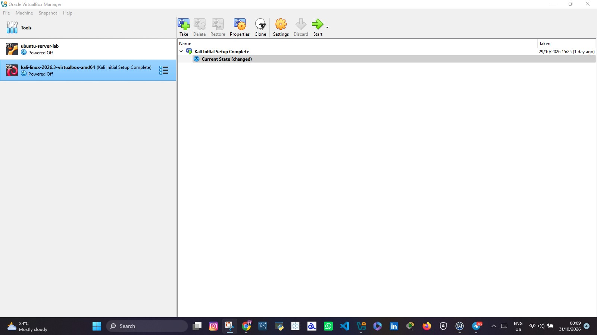
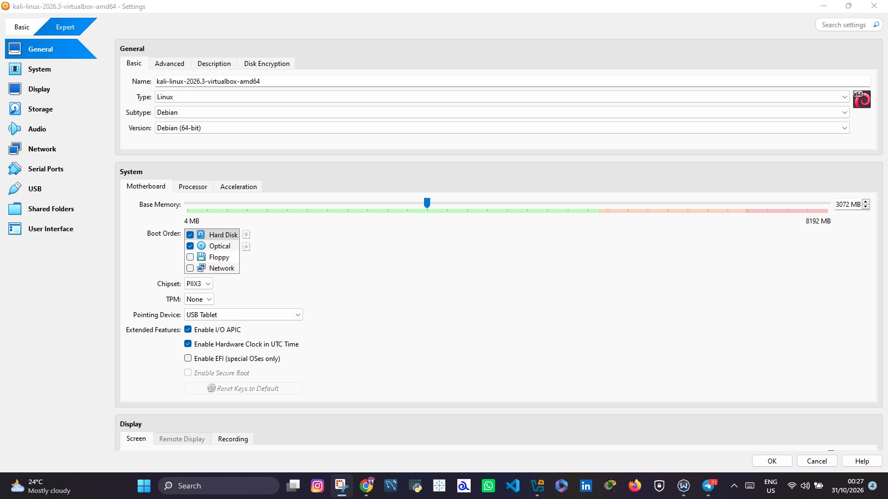
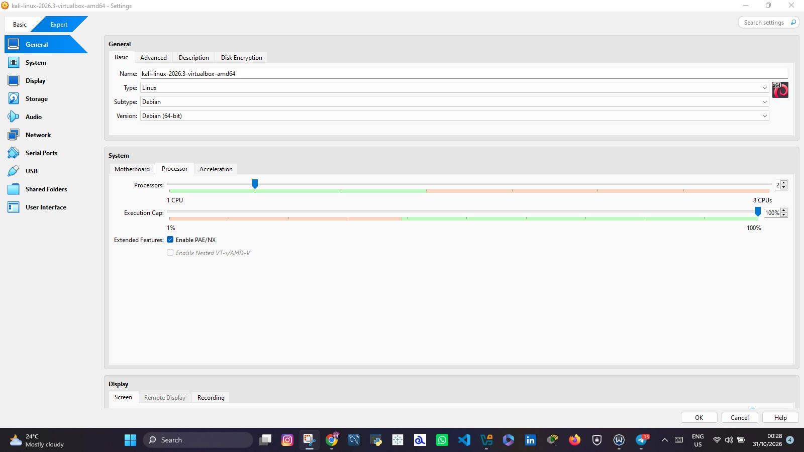
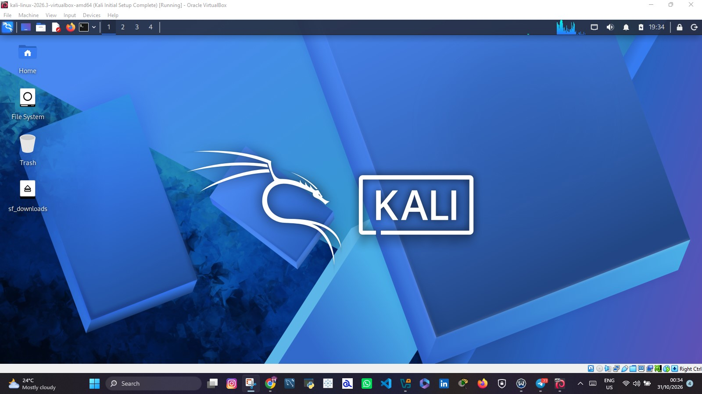
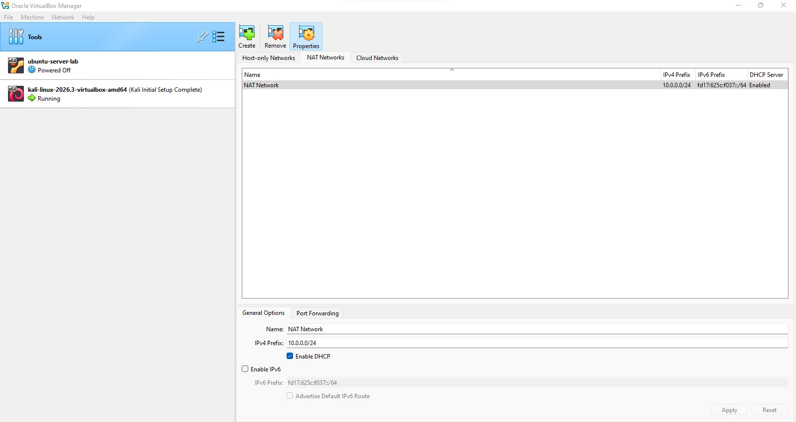
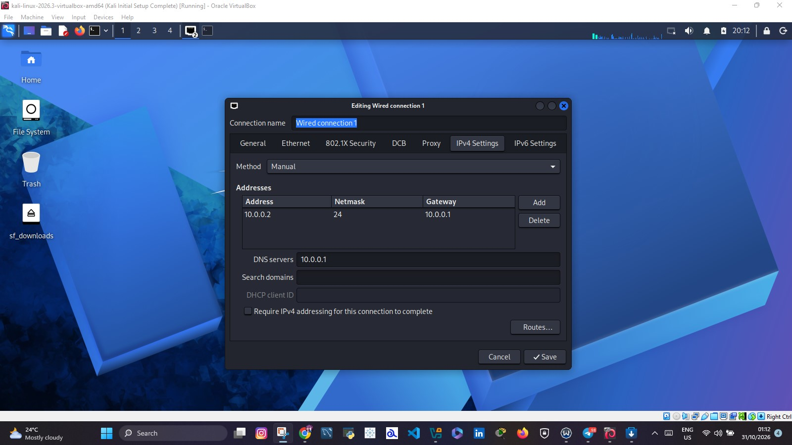
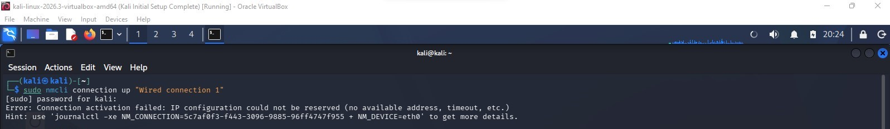
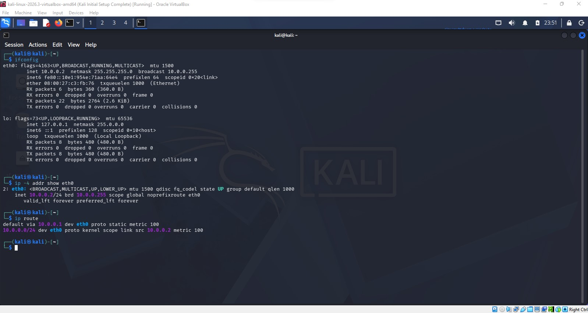
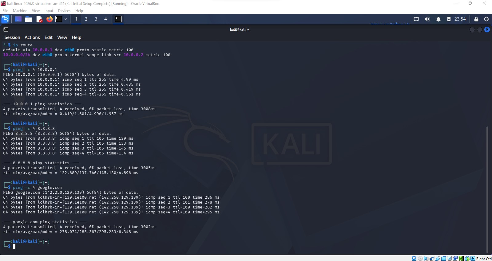

# networkwalks-B084-week1-Cybersecurity-Lab-Setup


<div align="center">

# 🔐 Cybersecurity Lab Environment Setup

**Building an isolated virtual lab for cybersecurity learning, network configuration and ethical hacking practice**

</div>

<p align="center">
  
  
  
  
  
  
  
  
  
  
</p>

---

## 📌 Project Overview

This project documents the setup and configuration of an isolated cybersecurity laboratory using Oracle VirtualBox and Kali Linux.

The objective was to establish a virtual environment for cybersecurity learning, network configuration, Linux administration and ethical hacking practice.

The project involved creating a custom NAT Network, importing Kali Linux, configuring its network interface and troubleshooting connectivity issues encountered during the setup.

## 🎯 Project Objectives

- Install and configure Oracle VirtualBox.
- Download and import Kali Linux.
- Create a custom NAT Network using the `10.0.0.0/24` subnet.
- Configure Kali Linux with the required static IP address.
- Establish network connectivity within the virtual machine.
- Troubleshoot network activation and DHCP-related issues.
- Document the configuration process and solutions.

---

## 🖥️ Lab Environment and Architecture

### Host Machine Specifications

| Component | Configuration |
|---|---|
| Host Machine | HP EliteBook 8770w |
| Operating System | Windows 11 |
| Hypervisor | Oracle VirtualBox 7.1.8 |
| Virtual Machine | Kali Linux 2026.3 |
| Allocated RAM | 3 GB |
| Allocated CPU | 2 vCPUs |
| Network Mode | NAT Network |

### Network Architecture

The lab uses a custom VirtualBox NAT Network.

| Parameter | Configuration |
|---|---|
| Network Name | NAT Network |
| IPv4 Prefix | 10.0.0.0/24 |
| Gateway | 10.0.0.1 |
| DHCP Server | 10.0.0.3 |
| DHCP Address Pool | 10.0.0.4 – 10.0.0.254 |
| DHCP | Enabled |
| Kali Static IP | 10.0.0.2 |
| Subnet Mask | 255.255.255.0 |

The Kali Linux virtual machine was configured to use a static IP address outside the DHCP allocation range.

---

## ⚙️ Tools and Technologies

| Tool | Purpose |
|---|---|
| Oracle VirtualBox | Virtualization |
| Kali Linux | Cybersecurity operating system |
| Windows 11 | Host operating system |
| 7-Zip | Archive extraction |
| PowerShell | VirtualBox management |
| NetworkManager | Linux network configuration |
| nmcli | Network configuration through the command line |

---

# 🚀 Implementation and Configuration

### Prepare the Host Machine

The host computer used for this project was an HP EliteBook 8770w running Windows 11.

Available system resources were considered before allocating memory and processing power to the virtual machine.

### Install Oracle VirtualBox

Oracle VirtualBox version 7.1.8 was installed and configured as the hypervisor.

VirtualBox provides the virtualization platform required to create and manage the Kali Linux virtual machine.



### Download and Import Kali Linux

The official Kali Linux prebuilt VirtualBox image was downloaded and extracted.

The virtual machine was subsequently imported into Oracle VirtualBox.

The following resources were allocated:

- RAM: 3 GB
- Processors: 2 vCPUs
- Network Adapter: NAT Network





**Screenshot – Kali Linux Desktop**



### Create and Configure the NAT Network

A dedicated NAT Network named `NAT Network` was configured through the VirtualBox Network Manager.

The network was configured with the following parameters:

```text
Network Name: NAT Network
IPv4 Prefix: 10.0.0.0/24
Gateway: 10.0.0.1
DHCP Server: 10.0.0.3
DHCP Pool: 10.0.0.4 - 10.0.0.254
DHCP: Enabled
```

The DHCP allocation range was configured to begin at `10.0.0.4`, leaving `10.0.0.2` outside the automatic address allocation pool for the Kali virtual machine's static configuration.



### Configure Kali Linux Network Adapter

The Kali Linux virtual machine was connected to the custom `NAT Network`.

The required static IPv4 configuration was:

```text
IP Address: 10.0.0.2
Subnet Mask: 255.255.255.0
Gateway: 10.0.0.1
DNS Server: 8.8.8.8
```

The network interface was configured through Kali Linux NetworkManager.



---

# 🔎 Network Troubleshooting and Resolution

During the configuration process, Kali Linux encountered a network activation failure.

This section documents the issue, the troubleshooting process and the solution that allowed the required static IP configuration to be applied successfully.

### Initial Network Activation Error

When attempting to activate the connection using NetworkManager, the following command was executed:

```bash
sudo nmcli connection up "Wired connection 1"
```

However, the connection failed to activate.

The terminal returned the following error:

```text
Error: Connection activation failed:
IP configuration could not be reserved
(no available address, timeout, etc.).
```

The network interface appeared as UP, but it did not successfully obtain an IPv4 address.

**Screenshot – Kali Linux Network Activation Error**



### Investigating the DHCP Configuration

To investigate the network configuration, the VirtualBox DHCP server settings were inspected using PowerShell.

The following command was executed:

```powershell
& "C:\Program Files\Oracle\VirtualBox\VBoxManage.exe" list dhcpservers
```

The `NAT Network` configuration showed:

```text
Network Name: NAT Network
DHCP Server IP: 10.0.0.3
Lower IP Address: 10.0.0.4
Upper IP Address: 10.0.0.254
Network Mask: 255.255.255.0
Enabled: Yes
```

This confirmed that the DHCP allocation range started at `10.0.0.4`, leaving `10.0.0.2` outside the configured DHCP pool.

### Applying the NetworkManager Compatibility Fix

After investigating the activation issue, the IPv4 Duplicate Address Detection timeout setting was adjusted.

The following command was executed:

```bash
sudo nmcli connection modify "Wired connection 1" ipv4.dad-timeout 0
```

This adjusted the IPv4 duplicate-address detection timeout for the NetworkManager connection.

### Configuring the Required Static IP Address

The connection was then configured manually with the required IPv4 settings:

```bash
sudo nmcli connection modify "Wired connection 1" ipv4.method manual ipv4.addresses 10.0.0.2/24 ipv4.gateway 10.0.0.1 ipv4.dns 8.8.8.8
```

The configuration specified:

- IPv4 method: Manual
- Static IP: `10.0.0.2/24`
- Default gateway: `10.0.0.1`
- DNS server: `8.8.8.8`

The connection was subsequently activated.

```bash
sudo nmcli connection up "Wired connection 1"
```

<badge color="success">Configuration activated</badge>

**Result:** The connection activated successfully, and Kali Linux received the required static IP address.

### Verifying the Static IP Configuration

To confirm that the static IP address had been applied, the following command was executed:

```bash
ip -4 addr show eth0
```

The output confirmed:

```text
eth0: UP
inet 10.0.0.2/24
```

The routing table was also checked:

```bash
ip route
```

The output showed:

```text
default via 10.0.0.1 dev eth0
10.0.0.0/24 dev eth0
```

These results confirmed that:

- The network interface was UP.
- The required static IP address was assigned.
- The correct subnet was configured.
- The default gateway was configured.

**Screenshot – Successful Static IP Configuration and Routing Table**



---

## 🧪 Network Connectivity Verification

After successfully configuring the static IP address, additional connectivity tests were identified to verify communication with the gateway, external networks and DNS services.

### Test 1: Gateway Connectivity

```bash
ping -c 4 10.0.0.1
```

Tests connectivity to the configured NAT Network gateway.

### Test 2: Internet Connectivity

```bash
ping -c 4 8.8.8.8
```

Tests outbound connectivity using Google's public DNS IP address.

### Test 3: DNS Resolution

```bash
ping -c 4 google.com
```

Checks whether DNS resolution and network connectivity are working.

**Screenshot – Gateway and Network Connectivity Test**



*Note: The static IP and routing configuration have been verified. Gateway, internet and DNS connectivity should only be marked as successful after their corresponding tests have been completed.*

---

## 🐞 Challenges and Lessons Learned

The major technical challenge encountered during this project was the Kali Linux network activation failure.

The issue demonstrated the importance of understanding the relationship between:

- VirtualBox NAT Network configuration.
- Static IPv4 addressing.
- DHCP address allocation.
- IPv4 Duplicate Address Detection.
- Linux NetworkManager.
- Network interface activation.

The troubleshooting process involved inspecting the VirtualBox DHCP configuration, adjusting the NetworkManager IPv4 duplicate-address detection timeout and manually configuring the required static IP address.

The connection subsequently activated successfully, and the required `10.0.0.2/24` configuration was verified using Linux networking commands.

### Key Learning Outcomes

Through this project, I gained practical experience in:

1. Virtual machine installation and management.
2. Configuring Kali Linux in VirtualBox.
3. Virtual networking and NAT configuration.
4. IPv4 addressing and subnet masks.
5. Static and automatic IP configuration.
6. DHCP configuration and troubleshooting.
7. Linux NetworkManager administration.
8. IPv4 Duplicate Address Detection.
9. Command-line network troubleshooting.
10. Technical documentation and problem resolution.

---

## 🔐 Security and Ethical Considerations

This lab is intended for educational purposes and authorized cybersecurity practice.

All security testing should be conducted within systems owned by the student or systems for which explicit permission has been granted.

---

## 🔗 Tools and References

- [Oracle VirtualBox](https://www.virtualbox.org/)
- [Kali Linux](https://www.kali.org/get-kali/)
- [7-Zip](https://www.7-zip.org/)
- [Networkwalks](https://networkwalks.com/)

---

## 👤 Author

**Ntangju Bryan Ache**

Cybersecurity Internship  
Networkwalks

**Project:** Cybersecurity Lab Environment Setup

**Technologies:** Kali Linux | VirtualBox | Windows 11 | NetworkManager

---

*This repository documents my practical experience in setting up, configuring and troubleshooting a virtual cybersecurity laboratory.*


